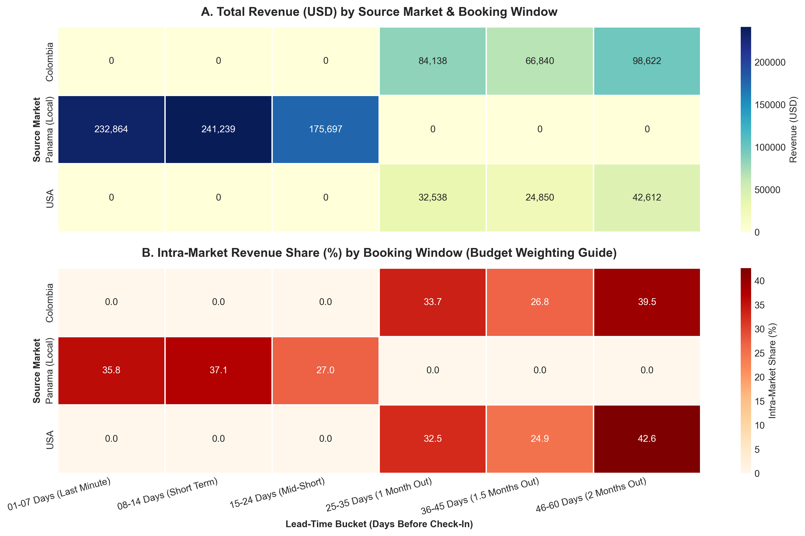
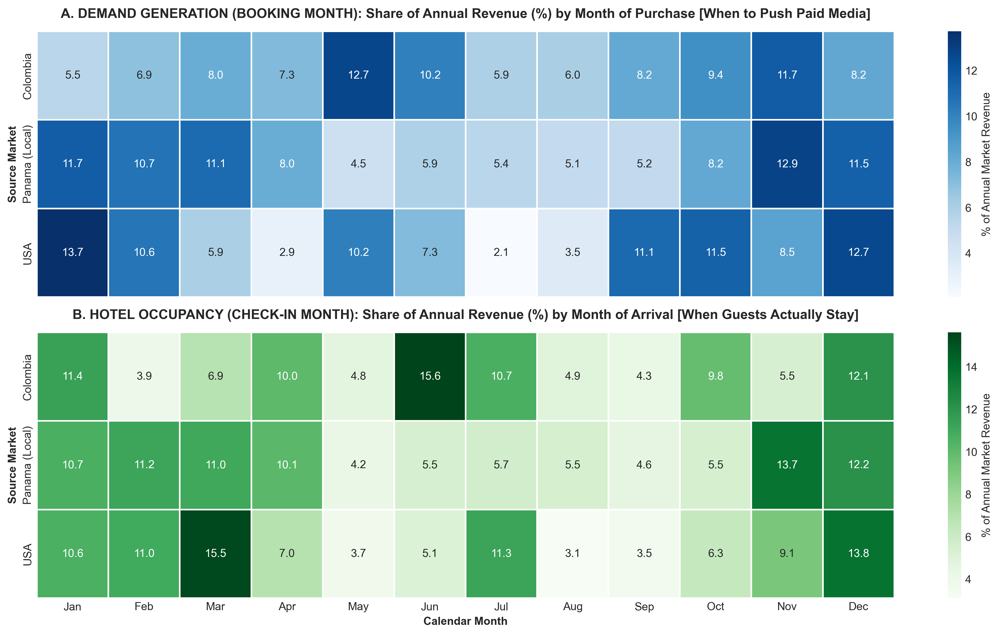
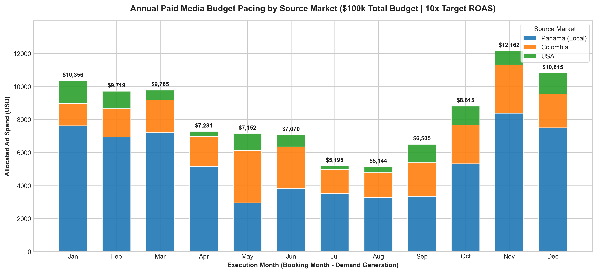

# Hotel Demand & Booking Window Forecasting for Paid Media Pacing

## Executive Summary
In hospitality performance marketing, allocating ad spend based on hotel occupancy months (**Check-In Date**) rather than purchase intent (**Booking Date**) creates severe budget inefficiencies—especially across international source markets with long lead times.

This project implements an end-to-end **Python Data Analytics & Budget Pacing Pipeline** for a 12-month hotel booking dataset ($1M USD annual revenue across 1,752 transactions). Using `Pandas`, `NumPy`, `Seaborn`, and `Matplotlib`, the model quantifies lead-time distributions across domestic and international markets and outputs an automated **$100,000 USD Paid Media Budget Pacing Calendar** with strict **Target CPA guardrails**.

---

## Visual Analytics & Model Outputs

### 1. Revenue Concentration & Booking Window by Market

### 2. Demand Generation (Booking Month) vs. Hotel Occupancy (Check-In Month) Lag

### 3. Automated Annual Paid Media Budget Pacing ($100k Target Spend | 10x ROAS)

---

## Key Analytical Findings
* **Domestic Last-Minute Concentration (Panama - 65% Revenue Share):** Exhibits a mean booking window of **10.1 days** (IQR: 5–15 days), with **72.97%** of revenue generated within 14 days of arrival. Requires *in-month* conversion and retargeting pacing with a strict **Max Target CPA of $45.03 USD** (ADR: $450).
* **International Advance Planning (Colombia - 25% Share | USA - 10% Share):** Both markets average a **~42-day booking window** (IQR: 33–52 days), concentrating ~40% of their purchases **46 to 60 days prior to Check-In**.
* **Counter-Cyclical Spend Pacing:** To capture Colombia's June/July peak occupancy, Paid Media investment must peak in **May ($3,182 USD)**—a month where domestic Panamanian demand is at its lowest ($2,951 USD). International high-ticket markets support higher acquisition thresholds (**Max Target CPA of $120.07 USD for Colombia** and **$100.06 USD for USA**).

---

## Repository Structure
* `demand_forecasting_pipeline.py` — Complete Python script (EDA, Feature Engineering, Heatmaps & Financial Pacing).
* `hotel_booking_demand_panama_en.csv` — Standardized raw booking dataset (1,752 records).
* `hotel_booking_demand_featured_en.csv` — Feature-engineered dataset with lead-time buckets and seasonality attributes.
* `paid_media_monthly_budget_pacing.csv` — Monthly ad spend allocation matrix ($100k annual budget).
* `paid_media_market_kpis_targets.csv` — Market-level KPI guardrails (ADR, IQR Lead Time, Target CPA).
* `requirements.txt` — Python library dependencies.

---

## Tech Stack
* **Language:** Python 3.x
* **Libraries:** `pandas`, `numpy`, `seaborn`, `matplotlib`
* **Operational Frameworks:** Lean Six Sigma (Poka-Yoke data integrity & CPA threshold controls), Hospitality Revenue & Paid Media Management.
